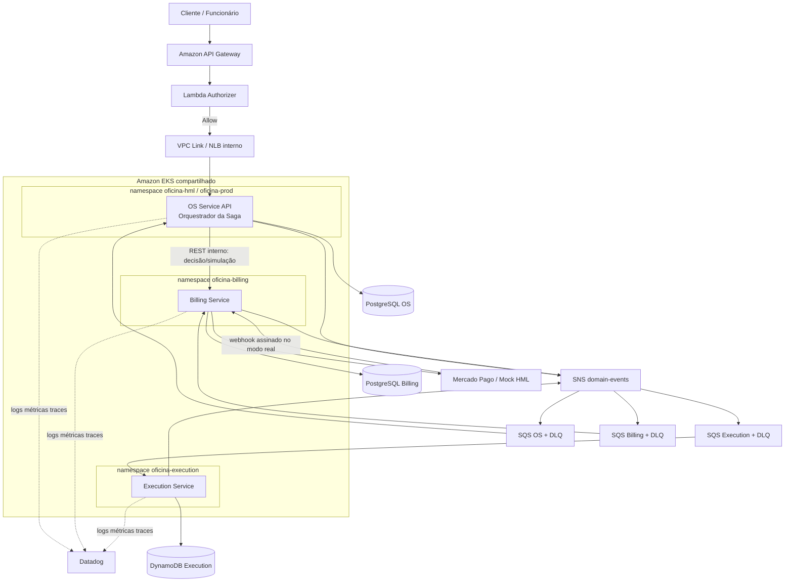

# Arquitetura-alvo da Fase 4

## Objetivo

Separar o sistema em serviços autônomos, com dados e deploy independentes,
mantendo consistência do fluxo da ordem de serviço sem transações distribuídas
ACID e sem acesso cruzado a bancos.

## Visão de componentes

O API Gateway publica a borda do OS Service. A fachada pública do OS encaminha
somente as operações humanas que pertencem ao Billing (aprovar/rejeitar e
simulação acadêmica) para o Service Kubernetes interno. O caminho crítico da
Saga continua assíncrono. O Execution Service não possui rota pública de escrita.

## Limites dos serviços

### OS Service

- abre e consulta ordens de serviço;
- mantém o histórico global e a projeção do estado da OS;
- mantém a instância, os passos e os deadlines da Saga;
- decide o próximo comando ou a compensação;
- armazena somente referências externas (`quoteId`, `executionId`,
  `paymentId`), nunca dados internos completos dos outros serviços.

### Billing Service

- cria, consulta, aprova, rejeita e cancela orçamentos;
- controla itens e valores do orçamento;
- cria, confirma, cancela e estorna pagamentos;
- encapsula Mercado Pago e mock pela porta `PaymentGateway`;
- não atualiza o banco da OS; publica eventos para o OS Service.

### Execution Service

- gerencia diagnóstico, fila, início, progresso e conclusão técnica;
- controla reservas de recursos/peças que pertençam ao seu domínio;
- persiste seu estado no DynamoDB;
- não decide o estado global da OS; publica eventos de execução.

## Serviços auxiliares que não contam como microsserviços de negócio

- `oficina-auth-function`: autenticação e autorização;
- `oficina-k8s-infra`: VPC, EKS e componentes compartilhados;
- `oficina-database-infra`: módulos/provisionamento de bancos;
- SNS/SQS, Datadog e provedor de pagamento.

## Comunicação

| Origem | Destino | Modo | Uso |
|---|---|---|---|
| Cliente/funcionário | APIs | REST | comandos humanos e consultas |
| OS | Billing | REST interno | decisão do orçamento e simulação controlada de HML |
| OS | Billing/Execution | SQS | comandos da Saga |
| Billing/Execution | OS | SNS/SQS | eventos de resultado |
| Provedor de pagamento | Billing | webhook HTTPS | confirmação assíncrona |
| Serviço | banco próprio | conexão privada | persistência exclusiva |

REST síncrono não é usado para coordenar as etapas transacionais da Saga. A
fachada de decisão é uma operação humana curta e não substitui os eventos:
Billing persiste a decisão e publica `QuoteApproved`/`QuoteRejected`; somente
então o orquestrador avança. Novas chamadas síncronas exigem timeout, tratamento
de indisponibilidade e ausência de dependência transacional.

## Infraestrutura e isolamento

- um EKS compartilhado para reduzir custo acadêmico, sem cluster por serviço;
- namespace, ServiceAccount, IAM, secrets, manifests e pipeline por serviço;
- filas e DLQs com policies de privilégio mínimo;
- banco/database/tabela e credencial exclusivos por serviço;
- nenhuma foreign key, join ou consulta cross-database;
- HPA independente para APIs/consumidores stateless;
- Datadog compartilhado com tags `service`, `env` e `version`.

## Independência por repositório

| Serviço/componente | Repositório | Infraestrutura e dado proprietário |
|---|---|---|
| OS Service | `maypinheiro/oficina-api` | manifests de workload, mensageria do orquestrador e PostgreSQL OS |
| Billing Service | `maypinheiro/oficina-billing-service` | RDS PostgreSQL Billing, fila/DLQ, manifests e pipeline próprios |
| Execution Service | `maypinheiro/oficina-execution-service` | DynamoDB, fila/DLQ, manifests e pipeline próprios |
| Plataforma | `maypinheiro/oficina-k8s-infra` | VPC, EKS, nodes, Datadog e componentes compartilhados |
| Autenticação | `maypinheiro/oficina-auth-function` | Lambda, Authorizer, API Gateway e VPC Link |

Compartilhar o cluster não significa compartilhar o ciclo de release: cada
microsserviço constrói sua imagem, aplica seus manifests, possui HPA/PDB e pode
ser implantado ou revertido sem publicar os demais.

## Requisitos de resiliência

- entrega pelo menos uma vez;
- produtores com Outbox nos serviços SQL;
- deduplicação por `messageId` nos consumidores;
- retry exponencial com jitter;
- DLQ e replay auditável;
- timeout por etapa da Saga;
- health/readiness separados da disponibilidade de dependências externas;
- handlers reentrantes e transições condicionais de estado.
