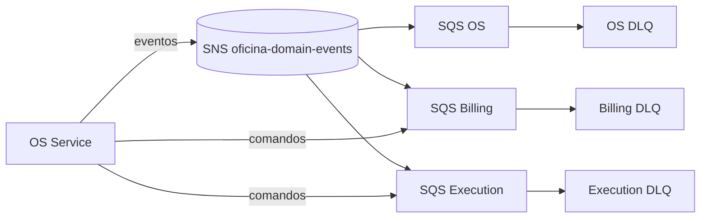

# Fase 3 — Mensageria básica e contratos

A fundação assíncrona foi implementada nos três microsserviços. Esta etapa entrega transporte e garantias técnicas; as transições completas e compensações da Saga pertencem à fase seguinte.

Cada serviço é proprietário de sua fila e DLQ; o OS Service é proprietário do tópico. A entrega é *at-least-once*: após cinco falhas a mensagem vai para a DLQ por 14 dias.

## Contrato versionado

O envelope v1 exige `messageId`, `messageType`, `messageKind`, `version`, `occurredAt`, `source`, `aggregateId`, `correlationId` e `payload`. `sagaId` e `causationId` preservam a cadeia causal. Eventos usam SNS; comandos usam a fila do destinatário. O parser suporta SQS direto e mensagens do SNS.

## Idempotência

- OS: chave única em `InboxMensagem.messageId` no PostgreSQL.
- Billing: chave única em `InboxMessage.messageId` no PostgreSQL.
- Execution: escrita condicional `INBOX#messageId` no DynamoDB, com TTL de 14 dias.

Uma repetição é reconhecida antes da ação de negócio. O hash SHA-256 do payload é armazenado para auditoria. A outbox SQL será conectada ao publicador na implementação da Saga.

## Infraestrutura e evidências

`infra/messaging` no OS cria SNS, fila OS e DLQ. O `infra` dos demais serviços cria sua fila, DLQ, policy limitada ao ARN do tópico e subscription. SQS usa criptografia, long polling de 20 s, retenção de quatro dias e visibility timeout de 60 s.

O provisionamento AWS depende de sessão temporária válida do AWS Academy. Aplica-se primeiro o módulo OS; seu output `domain_events_topic_arn` alimenta os demais. Os testes cobrem criação, versão, parsing SNS/SQS e duplicidade.
