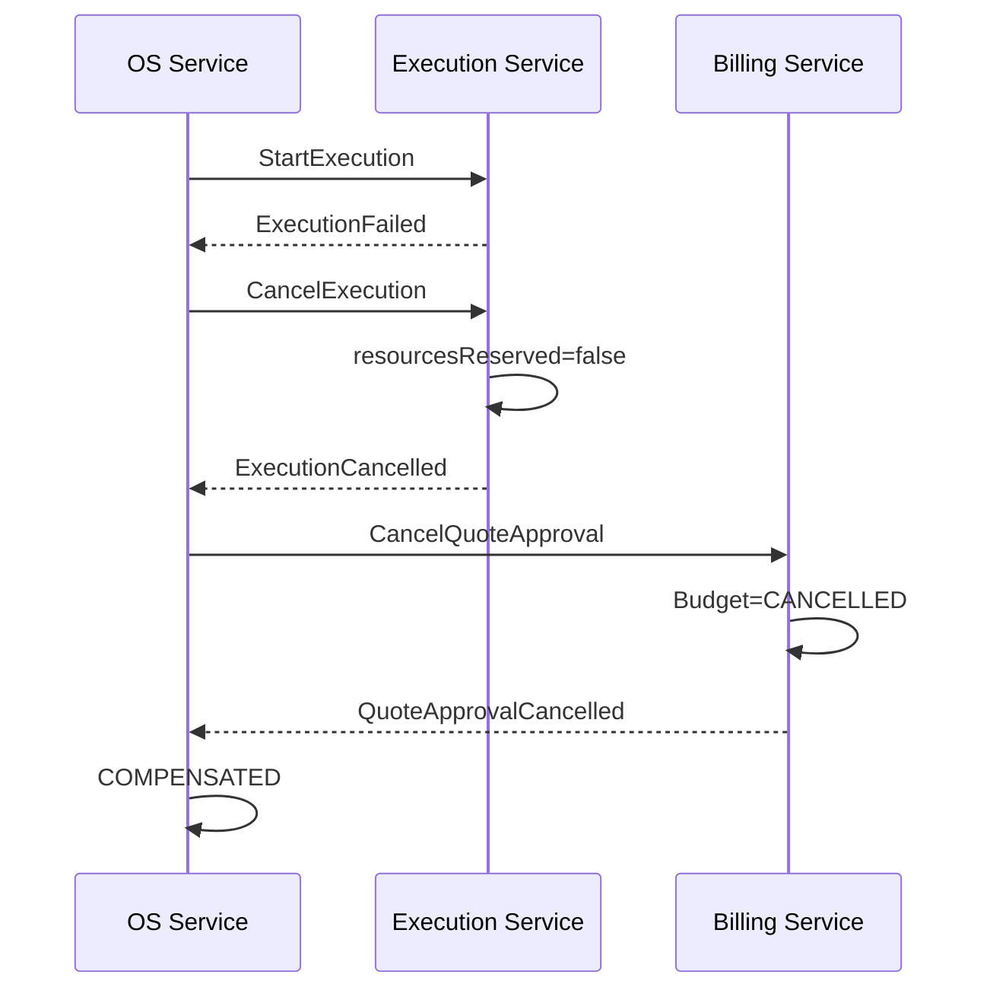

# Fase 4 — Saga orquestrada implementada

## Responsabilidades

O OS Service decide todas as transições globais. Billing e Execution não conhecem o fluxo completo: recebem um comando, executam uma transação apenas em seu banco e publicam um fato correlacionado. Nenhum serviço acessa o banco de outro.

## Máquina de estados executável

| Estado | Evento | Próximo estado | Comando |
|---|---|---|---|
| `OS_CREATED` | `StartSaga` | `WAITING_QUOTE` | `CreateQuote` |
| `WAITING_QUOTE` | `QuoteCreated` | `WAITING_APPROVAL` | — |
| `WAITING_APPROVAL` | `QuoteApproved` | `EXECUTION_REQUESTED` | `StartExecution` |
| `EXECUTION_REQUESTED` | `ExecutionStarted` | `IN_EXECUTION` | — |
| `IN_EXECUTION` | `ExecutionCompleted` | `WAITING_PAYMENT` | `RequestPayment` |
| `WAITING_PAYMENT` | `PaymentConfirmed` | `COMPLETED` | — |

Transições fora de ordem são rejeitadas. `COMPLETED`, `COMPENSATED` e `FAILED` são terminais.

## Consistência local

No OS Service, criação/atualização da Saga e inclusão na outbox ocorrem na mesma transação Prisma. O consumo também registra a inbox, usa controle otimista por `versao`, altera a etapa e cria o próximo comando atomicamente. Uma colisão em `messageId` retorna `duplicate` sem repetir efeitos.

Billing usa `upsert` por `externalOrderId` e chave `payment:<orderId>` para tornar orçamento e pagamento repetíveis. Execution usa escrita condicional no DynamoDB para iniciar uma execução e atualização determinística para cancelá-la.

## Compensação demonstrável

O cancelamento é sequencial e inverso aos efeitos confirmados. A Saga somente termina compensada após receber as duas confirmações.

## Evidências

- caminho feliz até `PaymentConfirmed`;
- falha na criação do orçamento terminando em `FAILED`;
- falha na execução com cancelamento da reserva e da aprovação;
- rejeição de evento fora de ordem;
- comandos compensatórios testados em Billing e Execution;
- preservação de `sagaId`, `correlationId` e `causationId`.

O provisionamento e o teste integrado em AWS dependem de credenciais temporárias válidas do AWS Academy. Os testes desta etapa são determinísticos e não dependem de serviços externos.
