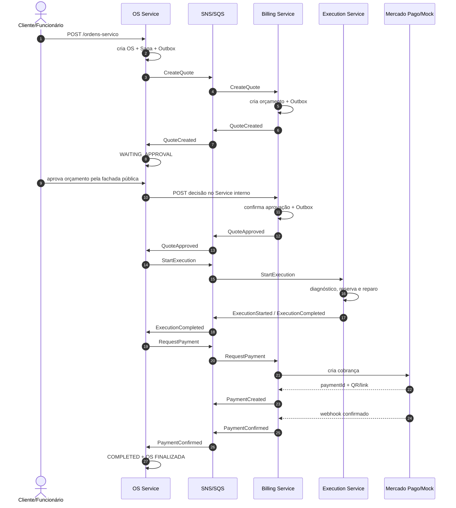
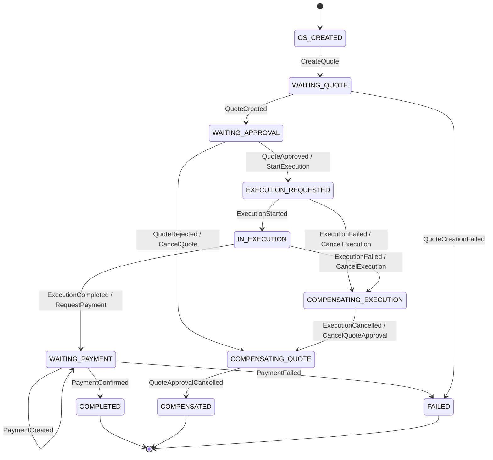
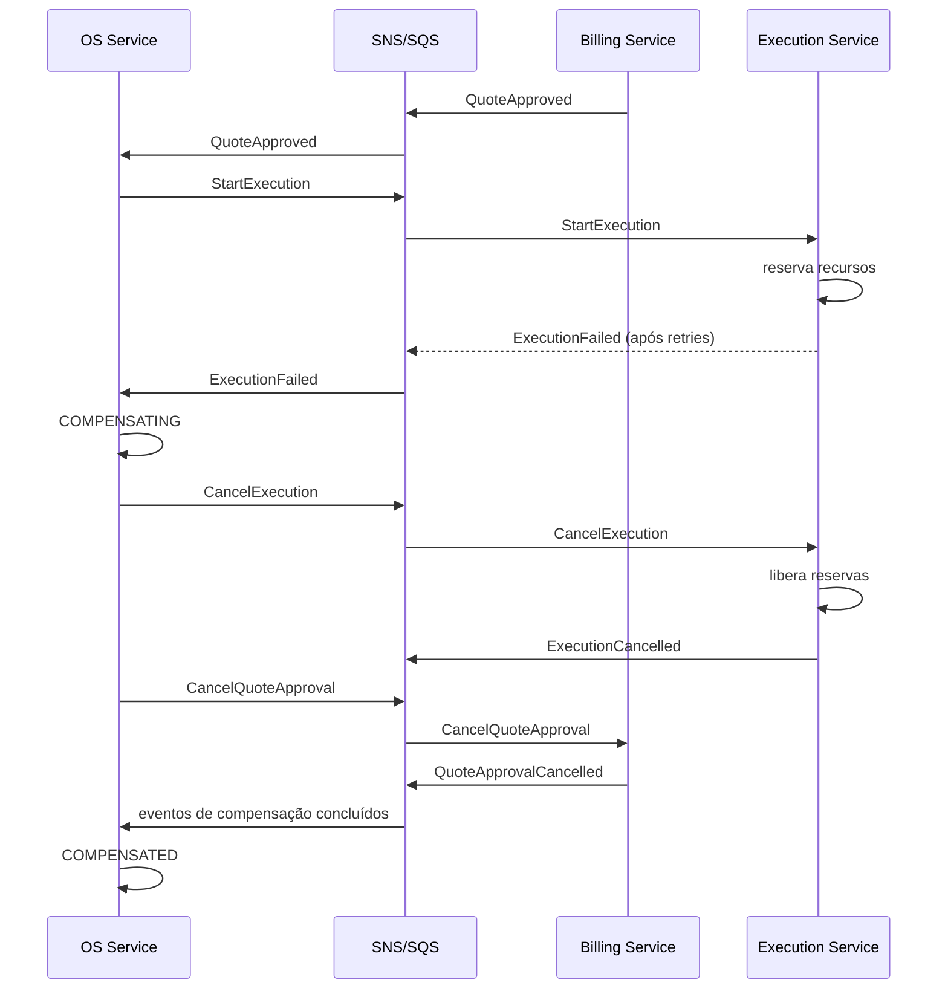

# Saga orquestrada da ordem de serviço

## Responsável

O OS Service é o orquestrador. Ele persiste a Saga, envia comandos, recebe
eventos e determina avanço, retry, falha ou compensação. Billing e Execution
executam somente transações locais e respondem com eventos.

## Identificadores

| Campo | Uso |
|---|---|
| `sagaId` | identifica a instância da Saga |
| `correlationId` | correlaciona HTTP, mensagens, logs e traces da jornada |
| `messageId` | deduplicação da mensagem |
| `causationId` | aponta para a mensagem que causou a atual |
| `aggregateId` | número/ID da ordem de serviço |

## Caminho feliz

## Máquina de estados

O diagrama acima corresponde aos estados implementados em
`src/contexts/saga/application/saga-machine.ts`. Os estados terminais são
`COMPLETED`, `COMPENSATED` e `FAILED`; eventos incompatíveis com o estado atual
são rejeitados e não alteram a Saga.

## Transações locais e eventos

Cada passo modifica somente o banco do serviço que o executa. Persistência de
estado e registro na Outbox ocorrem na mesma transação local. Um publicador lê a
Outbox e envia a mensagem; a publicação pode repetir, portanto os consumidores
devem deduplicar por `messageId`.

## Política de retry

1. falha transitória: até cinco tentativas com backoff exponencial e jitter;
2. falha de regra de negócio: não repetir automaticamente;
3. mensagem inválida ou tentativas esgotadas: DLQ;
4. o orquestrador decide se a etapa apenas falha ou inicia compensação;
5. replay de DLQ preserva o `messageId` original e registra operador/motivo.

Valores exatos de timeout e backoff serão configuráveis por ambiente. O código
não pode depender de sleeps fixos.

## Matriz de compensações

| Operação confirmada | Falha posterior | Comando compensatório | Resultado esperado |
|---|---|---|---|
| OS criada | orçamento nunca criado | nenhum rollback de negócio | OS marcada `FAILED_QUOTE`; intervenção/reprocessamento possível |
| orçamento criado | cliente rejeita | `CancelQuote` | orçamento cancelado e OS compensada/cancelada |
| orçamento aprovado | execução não inicia | `CancelQuoteApproval` | orçamento reaberto/cancelado e OS compensada |
| recursos reservados | execução falha | `CancelExecution` | reservas liberadas e execução cancelada |
| cobrança criada | cancelamento autorizado | `CancelPayment` | cobrança cancelada |
| pagamento confirmado | cancelamento autorizado | `RefundPayment` | estorno registrado e evento `PaymentRefunded` |

Registrar erro, enviar alerta ou mover mensagem para DLQ é tratamento de falha,
mas não é compensação. A compensação precisa desfazer um efeito de negócio já
confirmado.

## Fluxo de compensação demonstrável

## Invariantes

- uma OS possui no máximo uma Saga ativa;
- uma transição somente ocorre a partir de estados permitidos;
- evento duplicado não produz efeito duplicado;
- `COMPLETED`, `COMPENSATED` e `FAILED` são terminais;
- compensações são idempotentes e podem ser repetidas;
- nenhum consumidor atualiza o banco de outro serviço;
- toda mudança relevante é auditável por estado, mensagem e data.

## Cenários mínimos de aceite

1. caminho feliz completo até pagamento confirmado;
2. orçamento rejeitado;
3. falha transitória recuperada por retry;
4. falha de execução com liberação de reservas e cancelamento da aprovação;
5. mensagem duplicada sem efeito duplicado;
6. mensagem inválida enviada para DLQ;
7. replay auditável de mensagem da DLQ.
